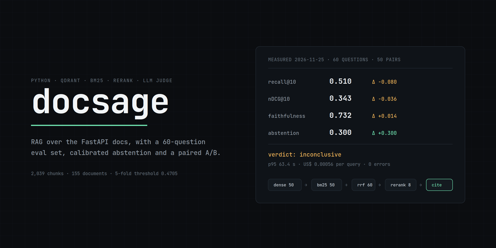
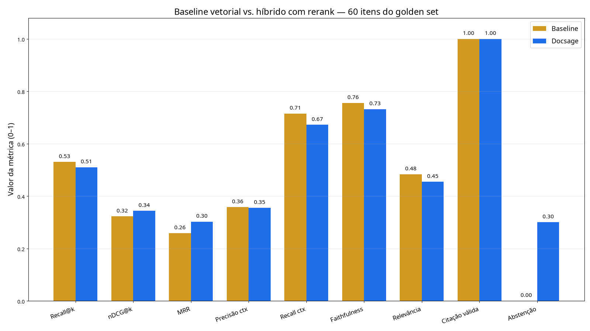
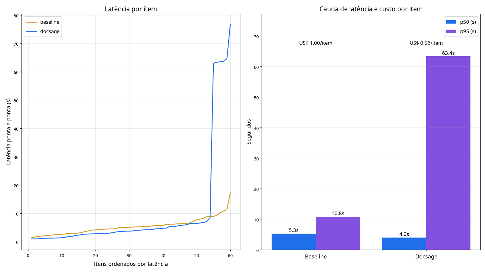
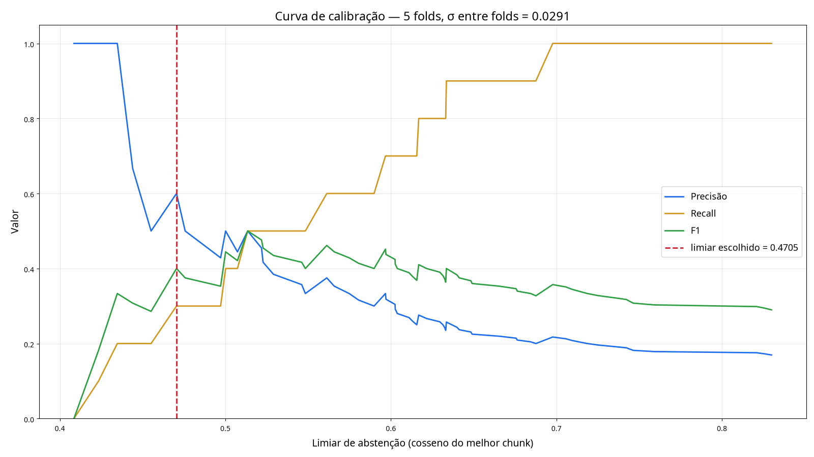
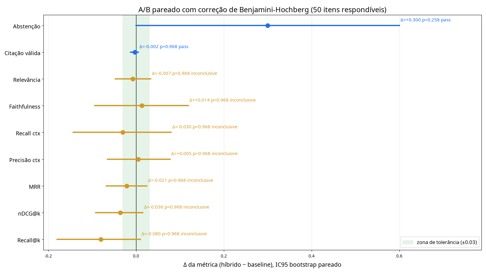
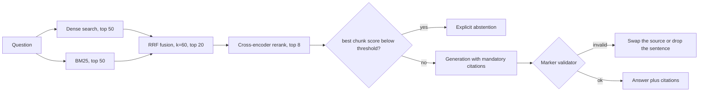

# docsage



RAG over the FastAPI documentation, shipped with the part that usually does not come along:
**a 60-question labelled evaluation set, a calibrated judge, abstention with a learned threshold,
and a paired A/B with bootstrap that runs in CI**.

The question this repo answers is not "can you put a RAG together?". It is "how do you know it
got better?".

**Português:** [README.pt-BR.md](README.pt-BR.md)

## Measured results

Corpus: FastAPI documentation `0.165.0` (`155` documents, `2,039` chunks, sha256
`1eea3e8336027b40…`). Golden set: `60` questions (`30` factual, `20` multi-hop, `10` with no
answer in the corpus). Measured on `2026-11-25`, commit `5f1c625`.

| Metric | Baseline (pure vector, no rerank) | docsage (hybrid + rerank) |
|---|---|---|
| recall@10 | 0.530 | **0.510** |
| nDCG@10 | 0.322 | **0.343** |
| MRR | 0.258 | **0.302** |
| context precision | 0.357 | **0.355** |
| context recall | 0.715 | **0.672** |
| faithfulness | 0.755 | **0.732** |
| answer relevance | 0.483 | **0.454** |
| citation validity | 100.0% | **100.0%** |
| abstention accuracy | 0.0% | **30.0%** |
| false abstention (answerable) | 0.0% | **6.0%** |
| latency p50 / p95 | 5.3 s / 10.8 s | 4.0 s / 63.4 s |
| cost per question | US$ 0.00100 | US$ 0.00056 |

Both runs (eval + baseline) cost US$ 0.08 in total. The three raw runs are versioned in
`eval-out/` (`current.json`, `baseline.json`, `ab.json`), so every number above can be checked
against the JSON that produced it.









### Paired A/B

`50` answerable pairs, 10,000 bootstrap resamples, Benjamini-Hochberg correction across the
metrics, α = 0.05. Verdict: **inconclusive**.

| Metric | Δ (docsage − baseline) | 95% CI | adjusted p | decision |
|---|---|---|---|---|
| recall@10 | -8.0% | [-0.180, 0.010] | 0.9681 | inconclusive |
| faithfulness | 1.4% | [-0.094, 0.119] | 0.9681 | inconclusive |
| citation validity | -0.2% | [-0.012, 0.005] | 0.9681 | pass |
| abstention | 30.0% | [0.000, 0.600] | 0.2583 | pass |

The minimum detectable effect at this n is 0.019 on recall@10 (0.128 on abstention, the noisiest
metric). Effects smaller than that cannot be told apart from noise.

Reading both numbers together forces a conclusion: the descriptive table above suggests a ranking
gain (nDCG 0.322 → 0.343, MRR 0.258 → 0.302), but the paired A/B, which controls for how hard
each question is, gives a Δ nDCG of **−3.6%** and a Δ MRR of **−2.1%**, both with confidence
intervals crossing zero. The two measurements disagree in sign, which at this sample size is
what noise looks like. The conclusion published here is the conservative one: **there is no evidence
that hybrid retrieval plus rerank helps on this corpus**. What the A/B does show
comfortably is abstention (+0.30, and the baseline simply never abstains) and the cost per
question, 40% lower because the generated context is shorter. The price is in the tail: p95 of
63 s against 11 s, because the cross-encoder runs serialized on CPU.

Full methodology, per-category breakdown and limitations in [`docs/RESULTS.md`](docs/RESULTS.md)
(in Portuguese).

## Pipeline



- **Dense**: `sentence-transformers/paraphrase-multilingual-MiniLM-L12-v2` (384 dimensions), Qdrant
  in embedded mode (`QDRANT_PATH`), no Docker.
- **Sparse**: BM25 implemented in the repo, with its own tokenizer and a disk cache.
- **Fusion**: Reciprocal Rank Fusion, `k=60`.
- **Rerank**: `BAAI/bge-reranker-v2-m3`, running inside `asyncio.to_thread` behind a semaphore,
  because a cross-encoder is CPU-bound and blocks the event loop when called directly.
- **Citations**: every sentence needs a `[[chunk_id]]` marker. The validator checks that the id
  exists among the retrieved chunks; when it does not, the sentence is dropped and the support
  rate falls. That is exactly what the validity metric measures.

## Abstention

The cosine threshold is learned, not eyeballed: 5-fold cross-validation over the `10` unanswerable
questions plus a sample of answerable ones, maximizing balanced accuracy. Calibrated threshold:
**0.4705**.

One implementation note that cost real time: the first version used the cross-encoder logit as the
abstention signal. It is degenerate for out-of-distribution chunks (every irrelevant chunk gets a
very negative logit, so the best-chunk score barely separates anything) and the curve sat at 0.5
accuracy. The signal that does separate is the **cosine of the best chunk**, and that is what the
pipeline uses.

## Evaluation

```bash
make calibrate   # learns the threshold (5 folds) and writes configs/calibrated.env
make eval        # 60 questions on the docsage arm
make eval-baseline
make ab          # paired A/B with bootstrap + Benjamini-Hochberg
make gate        # compares against eval/baseline.json, fails on regression beyond tolerance
make verdict     # reads the A/B and decides
```

- **Judge**: `gemini-3-flash-preview`, with separate rubrics for faithfulness, relevance and
  context precision. Every score is a Pydantic-validated JSON; if the judge returns something off
  schema, the call is retried and, on a second failure, the item is marked as not evaluated
  instead of silently becoming zero.
- **Regression baseline**: `eval/baseline.json` holds the metrics of the last accepted state.
  `make gate` compares against it with a 3 percentage point tolerance per metric.
- **Golden set**: `eval/golden.jsonl`, with annotated chunk ids. Loading validates that the ids
  exist in the current index before running, so an orphan annotation fails loudly instead of
  turning into a zero.

## Running it

```bash
cp .env.example .env            # OPENAI_API_KEY, OPENAI_BASE_URL, model names
make install
make corpus                     # downloads the FastAPI docs at the pinned commit and parses them
make index                      # chunks into the embedded Qdrant
make serve                      # POST /v1/query, GET /healthz, /readyz
```

A direct query:

```bash
python -m docsage.cli query "Como funciona injeção de dependência com yield?" --mode hybrid
```

The API is rate limited to 30 req/min per IP on `/v1/query` (slowapi) and 120/min globally,
returns `X-Request-ID`, and logs the latency of every stage.

## Models

| Role | Model | Why |
|---|---|---|
| Generation | `gpt-5-mini` | cheap enough to run 60 questions in minutes |
| Judge | `gemini-3-flash-preview` | a different model from the generator, so it is not grading itself |
| Embedding | `sentence-transformers/paraphrase-multilingual-MiniLM-L12-v2` | multilingual, 384d: the questions are in Portuguese and the corpus is in English |
| Rerank | `BAAI/bge-reranker-v2-m3` | multilingual cross-encoder, `max_length=192` to fit on CPU |

## Limitations

- **One corpus, one domain**: the FastAPI documentation. There is no evidence that these numbers
  transfer to source code, contracts or papers.
- **Small golden set**: `60` questions, annotated by one person. The A/B confidence interval is
  wide by construction, and the MDE is reported precisely so the project does not fake a precision
  it does not have.
- **Judge as a measurement**: faithfulness and relevance come from an LLM with a rubric, not from
  human annotation. Calibration against humans was not done; what exists is the care of using a
  different model from the generator and validating the response schema.
- **Binary abstention**: the system decides to answer or not. There is no "answer with a caveat".
- **No fine-tuning**: no model was adjusted; every gain comes from retrieval, fusion, rerank and
  prompting.
- **CPU only**: reranking 20 candidates costs about 1 s per question on 6 vCPU. With a GPU the
  `top_k` trade-off would change.

## Layout

```text
src/docsage/
  corpus/      fetch (pinned commit) and parse (markdown -> chunks with metadata)
  index/       bm25, vectors, store (embedded Qdrant), build
  retrieve/    hybrid (RRF), rerank (cross-encoder), pipeline
  generate/    prompts, answer (mandatory citations), cite (validator)
  eval/        dataset, retrieval_metrics, ragas_metrics, judges, run_eval, ab, gate, report
  api/         FastAPI with rate limiting and request id
  calibrate.py learns the abstention threshold
eval/          golden.jsonl, baseline.json
configs/       eval.yaml, calibrated.env.example
scripts/       measure.sh, reproduce.sh, plot_results.py
docs/          ARCHITECTURE.md, EVALUATION.md, RESULTS.md, OBSERVABILITY.md, LOCAL.md, img/
```

The documents under `docs/` are written in Portuguese.

## Tests

```bash
make test    # pytest, 72% coverage
make lint    # ruff
```

## License

MIT.
