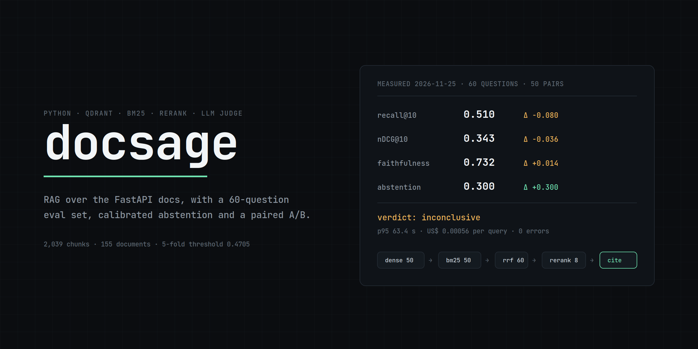
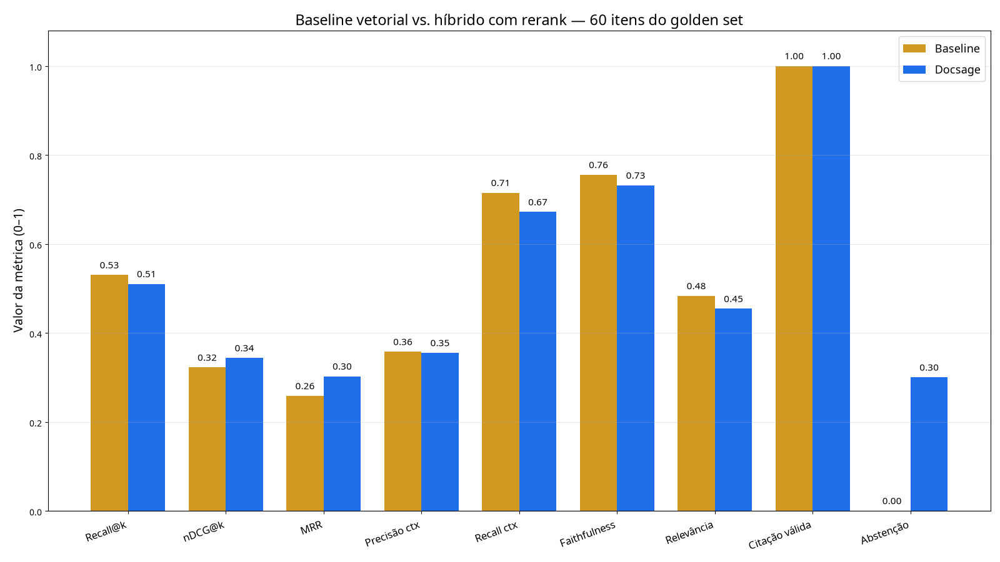
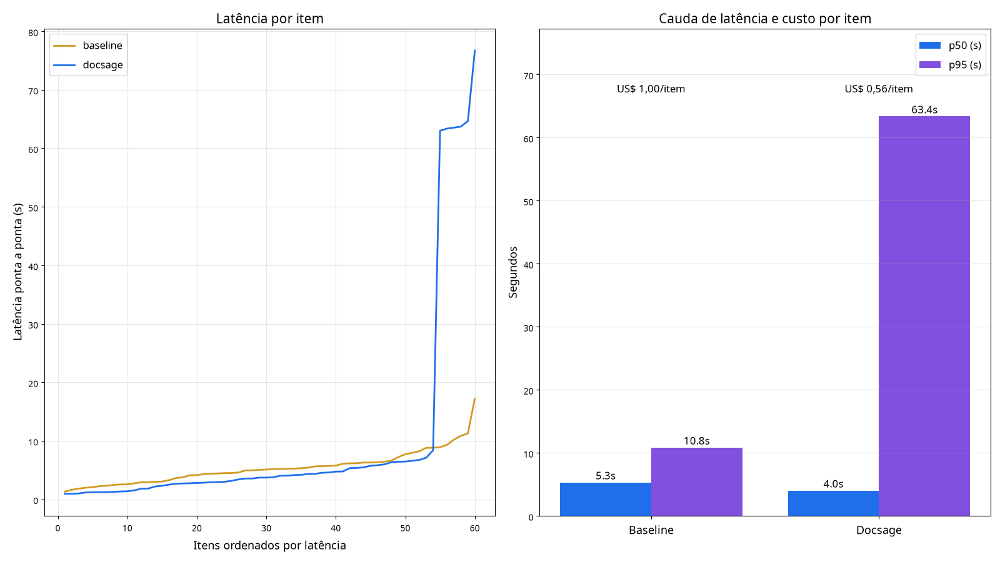
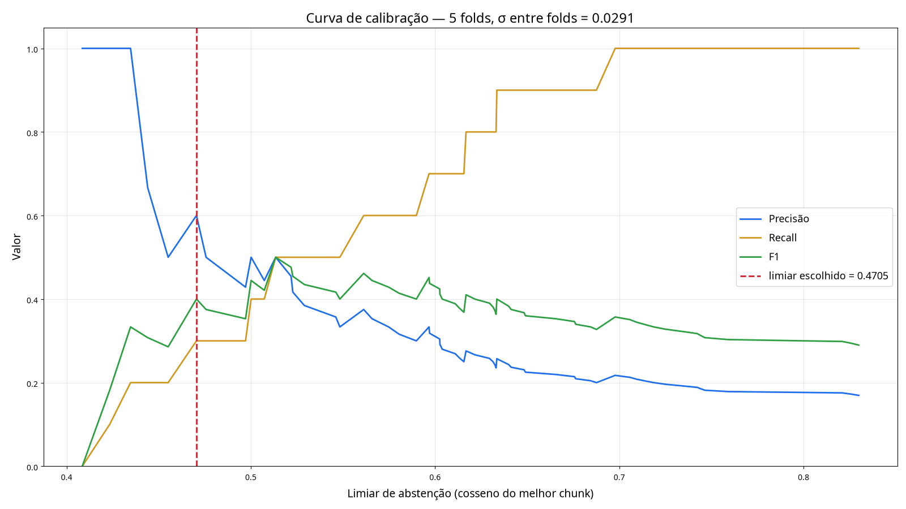
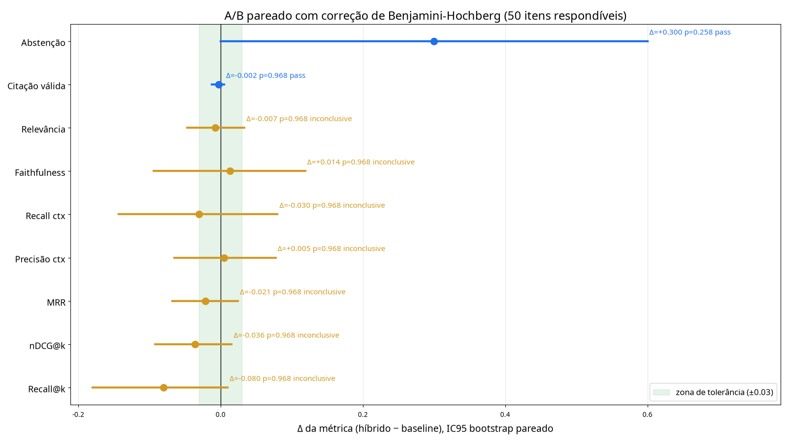
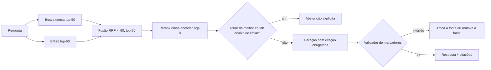

# docsage



RAG sobre a documentação do FastAPI, com o que quase nunca vem junto: **conjunto de avaliação
com 60 perguntas rotuladas, juiz calibrado, abstenção com limiar aprendido e um A/B pareado com
bootstrap que roda no CI**.

A pergunta que este repo responde não é "dá para montar um RAG?". É "como você sabe que ele
melhorou?".

**English:** [README.md](README.md)

## Resultados medidos

Corpus: documentação do FastAPI `0.165.0` (`155` documentos,
`2039` chunks, sha256 `1eea3e8336027b40…`). Golden set: `60` perguntas
(`30` factuais, `20` multi-hop, `10` sem resposta no
corpus). Medição de `2026-11-25`, commit `5f1c625`.

| Métrica | Baseline (vetorial puro, sem rerank) | docsage (híbrido + rerank) |
|---|---|---|
| recall@10 | 0,530 | **0,510** |
| nDCG@10 | 0,322 | **0,343** |
| MRR | 0,258 | **0,302** |
| context precision | 0,357 | **0,355** |
| context recall | 0,715 | **0,672** |
| faithfulness | 0,755 | **0,732** |
| answer relevance | 0,483 | **0,454** |
| validade de citação | 100,0% | **100,0%** |
| acurácia de abstenção | 0,0% | **30,0%** |
| abstenção indevida (respondível) | 0,0% | **6,0%** |
| latência p50 / p95 | 5,3 s / 10,8 s | 4,0 s / 63,4 s |
| custo por pergunta | US$ 0,00100 | US$ 0,00056 |

Custo total das duas execuções (eval + baseline): US$ 0,08. As três execuções brutas estão
versionadas em `eval-out/` (`current.json`, `baseline.json`, `ab.json`), então qualquer número
acima pode ser conferido contra o JSON que o produziu.








### A/B pareado

`50` pares respondíveis, 10.000 reamostragens de bootstrap, correção de
Benjamini-Hochberg sobre as métricas, α = 0,05. Veredito: **inconclusivo**.

| Métrica | Δ (docsage − baseline) | IC95 | p ajustado | decisão |
|---|---|---|---|---|
| recall@10 | -8,0% | [-0,180, 0,010] | 0,9681 | inconclusivo |
| faithfulness | 1,4% | [-0,094, 0,119] | 0,9681 | inconclusivo |
| validade de citação | -0,2% | [-0,012, 0,005] | 0,9681 | passa |
| abstenção | 30,0% | [0,000, 0,600] | 0,2583 | passa |

O efeito mínimo detectável com esse n é 0,019 em recall@10 (0,128 em abstenção, a métrica mais
ruidosa). Ou seja: ganhos menores que isso o experimento não distingue de ruído.

A leitura que os dois números juntos obrigam: a tabela descritiva acima sugere ganho de ranking
(nDCG 0,322 → 0,343, MRR 0,258 → 0,302), mas o A/B pareado, que controla a dificuldade de cada
pergunta, dá Δ nDCG de **−3,6%** e Δ MRR de **−2,1%**, ambos com IC cruzando zero. As duas
medições discordam em sinal, o que é a definição de ruído nesse tamanho de amostra. A conclusão
publicada aqui é a conservadora: **não há evidência de que híbrido + rerank melhore a recuperação
neste corpus**. O que o A/B mostra com folga é a abstenção (+0,30, e o baseline simplesmente não
abstém) e o custo por pergunta, 40% menor porque o contexto gerado é mais curto. O preço está na
cauda: p95 de 63 s contra 11 s, porque o cross-encoder roda serializado em CPU.

## Pipeline



- **Densa**: `sentence-transformers/paraphrase-multilingual-MiniLM-L12-v2` (384 dimensões), Qdrant em modo embutido (`QDRANT_PATH`), sem Docker.
- **Esparsa**: BM25 implementado no repo, com tokenização própria e cache em disco.
- **Fusão**: Reciprocal Rank Fusion, `k=60`.
- **Rerank**: `BAAI/bge-reranker-v2-m3`, rodando em `asyncio.to_thread` com semáforo, porque cross-encoder
  é CPU-bound e trava o event loop se chamado direto.
- **Citação**: cada frase precisa de um marcador `[[chunk_id]]`; o validador confere se o id
  existe entre os chunks recuperados e, se não existir, a frase é removida e a taxa de suporte
  cai. Isso é o que a métrica de validade mede.

## Abstenção

O limiar de cosseno é aprendido, não escolhido no olho: validação cruzada de 5 folds sobre as
`10` perguntas sem resposta mais uma amostra de respondíveis, maximizando
acurácia balanceada. Limiar calibrado: **0,4705**.

Uma nota de implementação que custou caro: a primeira versão usava o logit do cross-encoder
como sinal de abstenção. Ele é degenerado para chunks fora de distribuição (todo chunk
irrelevante recebe logit muito negativo, então o score do melhor chunk quase não separa), e a
curva ficou em 0,5 de acurácia. O sinal que separa de verdade é o **cosseno do melhor chunk**,
e é ele que o pipeline usa.

## Avaliação

```bash
make calibrate   # aprende o limiar (5 folds) e grava configs/calibrated.env
make eval        # 60 perguntas no braço docsage
make eval-baseline
make ab          # A/B pareado com bootstrap + Benjamini-Hochberg
make gate        # compara com eval/baseline.json, falha se regredir além da tolerância
make verdict     # lê o A/B e decide
```

- **Juiz**: `gemini-3-flash-preview`, com rubricas separadas para faithfulness, relevância e precisão de
  contexto. Cada nota é um JSON validado por Pydantic; se o juiz devolver algo fora do schema,
  a chamada é repetida e, na segunda falha, o item é marcado como não avaliado em vez de virar
  zero silencioso.
- **Baseline de regressão**: `eval/baseline.json` guarda as métricas do último estado aceito.
  `make gate` compara com tolerância de 3 pontos percentuais por métrica.
- **Golden set**: `eval/golden.jsonl`, com ids de chunk anotados. O carregamento valida que os
  ids existem no índice atual antes de rodar; anotação órfã falha alto em vez de virar zero.

## Rodar

```bash
cp .env.example .env            # OPENAI_API_KEY, OPENAI_BASE_URL, modelos
make install
make corpus                     # baixa a doc do FastAPI no commit fixo e faz o parse
make index                      # chunks no Qdrant embutido
make serve                      # POST /v1/query, GET /healthz, /readyz
```

Consulta direta:

```bash
python -m docsage.cli query "Como funciona injeção de dependência com yield?" --mode hybrid
```

A API tem limite de 30 req/min por IP no `/v1/query` (slowapi) e 120/min global, devolve
`X-Request-ID` e loga latência de cada estágio.

## Modelos

| Papel | Modelo | Por quê |
|---|---|---|
| Geração | `gpt-5-mini` | barato o bastante para rodar 60 perguntas em minutos |
| Juiz | `gemini-3-flash-preview` | modelo diferente do gerador, para não medir a si mesmo |
| Embedding | `sentence-transformers/paraphrase-multilingual-MiniLM-L12-v2` | multilíngue, 384d: as perguntas são em português e o corpus em inglês |
| Rerank | `BAAI/bge-reranker-v2-m3` | cross-encoder multilíngue, `max_length=192` para caber em CPU |

## Limitações

- **Um corpus, um domínio**: a documentação do FastAPI. Não há evidência de que os números se
  transfiram para código, contratos ou artigos.
- **Golden set pequeno**: `60` perguntas, anotadas por uma pessoa. O intervalo de
  confiança do A/B é largo por construção, e o MDE aparece no relatório justamente para não
  fingir precisão que não existe.
- **Juiz como medida**: faithfulness e relevância vêm de um LLM com rubrica, não de anotação
  humana. A calibração contra humano não foi feita; o que existe é o cuidado de usar um modelo
  diferente do gerador e de validar o schema da resposta.
- **Abstenção binária**: o sistema decide responder ou não. Não há "responder com ressalva".
- **Sem fine-tuning**: nenhum modelo foi ajustado; todo ganho vem de recuperação, fusão,
  rerank e prompt.
- **CPU apenas**: o rerank de 20 candidatos custa cerca de 1 s por pergunta em 6 vCPU. Com GPU
  o trade-off de `top_k` mudaria.

## Estrutura

```text
src/docsage/
  corpus/      fetch (commit fixo) e parse (markdown -> chunks com metadata)
  index/       bm25, vectors, store (Qdrant embutido), build
  retrieve/    hybrid (RRF), rerank (cross-encoder), pipeline
  generate/    prompts, answer (citação obrigatória), cite (validador)
  eval/        dataset, retrieval_metrics, ragas_metrics, judges, run_eval, ab, gate, report
  api/         FastAPI com rate limit e request id
  calibrate.py aprende o limiar de abstenção
eval/          golden.jsonl, baseline.json
configs/       eval.yaml, calibrated.env.example
scripts/       measure.sh, reproduce.sh, plot_results.py
docs/          ARCHITECTURE.md, EVALUATION.md, RESULTS.md, OBSERVABILITY.md, LOCAL.md, img/
```

## Testes

```bash
make test    # pytest, 72% de cobertura
make lint    # ruff
```

## Licença

MIT.
