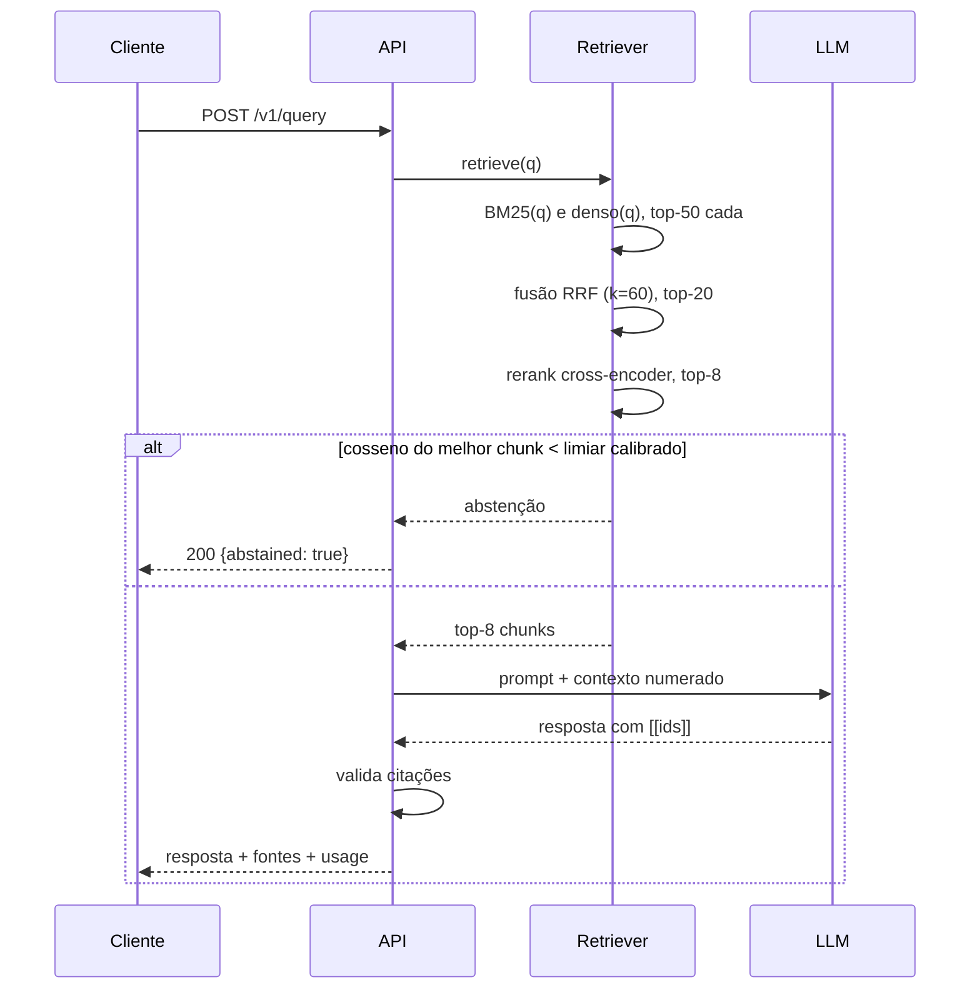

# Arquitetura

## Fluxo de uma consulta

## Decisões e por quê

**Híbrido em vez de vetorial puro.** Embeddings erram em identificadores raros: nome de
parâmetro, flag de CLI, código de erro. BM25 acerta exatamente nesses casos. A fusão RRF
(`k=60`) combina os dois rankings sem calibrar escalas de score, que é o motivo de RRF ser
preferível a soma ponderada aqui.

**Embedding multilíngue.** O corpus é em inglês e as perguntas do golden set são em português.
`paraphrase-multilingual-MiniLM-L12-v2` (384 dimensões) pareia os dois idiomas; um modelo só
de inglês recuperava o chunk certo com frequência bem menor.

**Rerank cross-encoder depois da fusão.** O bi-encoder pontua consulta e documento
independentemente; o cross-encoder vê os dois juntos e resolve os casos em que o vocabulário
coincide mas o significado não. É caro, então roda só sobre os 20 candidatos fundidos e corta
para 8.

**Rerank serializado.** O cross-encoder já usa todas as threads do processo. Rodar N reranks em
paralelo multiplica threads pelo paralelismo e trava a máquina: medido aqui, 6 reranks
simultâneos em 6 vCPU deram cerca de 6× menos vazão por item. O semáforo em
`retrieve/pipeline.py` (`RERANK_CONCURRENCY=1`) mantém a CPU ocupada de forma útil e deixa o
paralelismo para as chamadas de LLM, que são I/O.

**Gate de abstenção antes da geração.** Se o cosseno do melhor chunk fica abaixo do limiar
calibrado, respondemos "não encontrado" em vez de deixar o modelo preencher lacuna. O limiar
vem de validação cruzada (`docs/EVALUATION.md`), não de chute.

**Citações validadas depois da geração.** O modelo emite `[[chunk_id]]`; o validador confere se
o id existe no contexto recuperado, remove marcador órfão e calcula cobertura por sentença.
Sentença sem citação válida é marcada como não suportada, e isso vira métrica.

**Cliente LLM com semáforo e retry.** O provedor compatível com OpenAI pode devolver 200 com
`choices` nulo sob rajada. O cliente (`llm.py`) limita chamadas simultâneas
(`LLM_CONCURRENCY`), tenta de novo com backoff exponencial e trata `choices` nulo como erro, não
como resposta vazia. Um item que ainda assim falha é marcado com `error` e sai das médias em
vez de virar zero.

## Componentes

| Módulo | Responsabilidade |
|---|---|
| `corpus/fetch.py` | clona o repo-alvo no commit fixado (reprodutibilidade) |
| `corpus/parse.py` | chunker Markdown consciente de headings e code fences |
| `index/bm25.py` | índice lexical persistido em disco |
| `index/vectors.py` | embeddings e upsert no Qdrant |
| `index/store.py` | cliente Qdrant embutido (`QDRANT_PATH`) ou remoto |
| `retrieve/hybrid.py` | execução paralela e fusão RRF |
| `retrieve/rerank.py` | cross-encoder local (ou Cohere) |
| `retrieve/pipeline.py` | orquestra busca, rerank e decisão de abstenção |
| `generate/answer.py` | prompt, chamada ao modelo, citação obrigatória |
| `generate/cite.py` | validação e relatório de citações |
| `calibrate.py` | aprende o limiar de abstenção por validação cruzada |
| `eval/` | golden set, métricas, juízes, A/B, gate, relatório |
| `api/main.py` | HTTP, rate limit, request-id, métricas Prometheus |

## Orçamento de contexto

`MAX_CONTEXT_TOKENS=6000`. O montador de contexto descarta chunks do fim do ranking até caber e
nunca trunca um chunk no meio: truncar no meio quebra a citação de span.

## Índice

| Item | Valor |
|---|---|
| Corpus | documentação do FastAPI, commit `05e6df7e906c3decba377c37548019973f40bf15` |
| Chunks | 2039, gerados por `make corpus` |
| Vetores | 384 dimensões, Qdrant embutido em `data/qdrant_local` |
| Lexical | BM25 persistido em `.bm25/index.pkl` |

`data/corpus`, `data/qdrant_local` e `.bm25` não são versionados: `make corpus` e `make index`
regeneram tudo a partir do commit fixado. O `data/chunks.jsonl` é versionado (2,1 MB) para que
o sha256 publicado em `docs/RESULTS.md` seja verificável sem baixar o corpus.

## Limites conhecidos

- BM25 em memória: confortável até ~50k chunks; acima disso, troque por OpenSearch.
- Chunker é Markdown-específico: não serve para PDF escaneado.
- Uma instância, sem sharding: o gargalo é o rerank em CPU.
